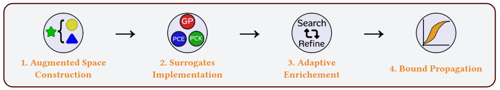
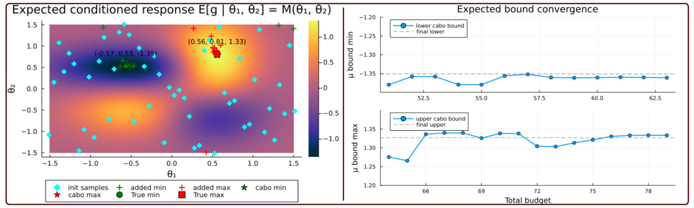
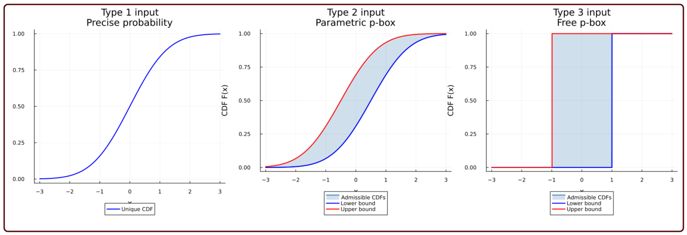
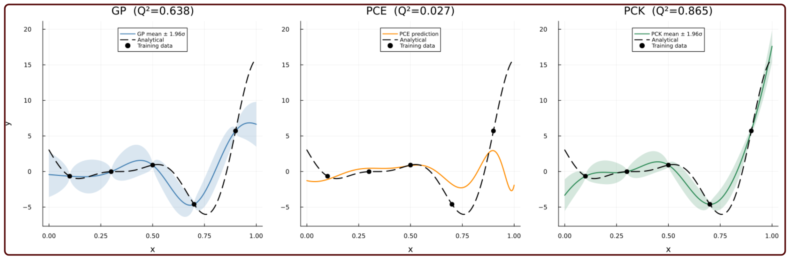

# SurrogateModelling.jl

**A surrogate-based propagation of imprecise probabilities through expensive numerical models, in Julia.**

<p align="center">
    
</p>


> **Headline result:** On a 2D Gaussian-mixture benchmark, CABO recovers the bounds of the expected response to $\leq 1 \%$ **relative error** with **27 true-model calls**, versus $3 \times 10^7$ for a brute-force double-loop Monte Carlo reference.

<p align="center">
  
</p>

---

## Context

- **Expensive models:** FE/CFD simulations can take hours up to days per run.
- **Imprecise inputs:** Some inputs are only known as intervals or distribution families (p-boxes), i.e. a mix of aleatory and epistemic uncertainty.
- **Intractable propagation:** bounding a QoI needs a double loop, epistemic outer $\times$ aleatory inner, which means millions of model calls

**This package:** build a surrogate in an augmented standard-normal space and use a *Collaborative and Adaptive Bayesian Optimization* (*CABO*) to place the few true-model calls where they tighten the bounds.

This repository accompanies my **Master's thesis** in **Computational Engineering** at **Leibniz University Hannover**, carried out at the **Institute for Risk and Reliability**.

## Features
### 1. Augmented space construction
Each input is classified by its type of uncertainty and mapped to standard normal coordinates $w = (u, v)$:
- $u$ an aleatory variable
- $v$ an epistemic variable

<p align="center">
  
</p>

<div align="center">

|             | Type-I  | Type-II | Type-III |
|-------------|---------|---------|----------|
| Description | Precise distribution | Parametric p-box | Interval |
| Model       | $F_X(x)$ | $F_{X\mid\theta}(x), \theta \in [\theta^L,\theta^U]$ | $x \in [x^L,x^U]$ |
| Coordinates | $u$ | $u,v_1,\dots,v_n$ | $v$ |
| Spec type   | `PreciseSpec` | `HybridSpec` | `IntervalSpec` |

</div>

The snippet below defines three random variables from `UQ.jl`, **a precise variable** $x_1$ (pure aleatory), **an imprecise parametric variable** $x_2$ (mixture of aleatory and epistemic) and **an interval variable** $x_3$ (pure epistemic). `SM.jl` generates the augmented specification from it, and can give two dataframes:
- `data_augmented`: samples of augmented coordinates $w = (u_1, u_2, v_{2_{1}}, v_{2_{2}}, v_3)$
- `data_physical`: physical coordinates $x = (x_1, x_2, x_3)$

```julia
using UncertaintyQuantification
using SurrogateModelling

# creating precise/imprecise random variables (from UQ.jl)
x1 = RandomVariable(Normal(0, 1), :x1) # pure aleatory -> u1
x2 = RandomVariable(ProbabilityBox{Normal}(
  Dict(
    :μ => Interval(-1.5, -1.5), # -> v2_1 
    :σ => Interval(0.1,   0.5)  # -> v2_2
  )), :x2 # -> u2
)
x3 = IntervalVariable(-π, π, :x3) # pure epistemic -> v3

# creating model (UQ.jl)
model = Model(df -> df.x1 .+ df.x2 .+ df.x3, :y)

# building augmented space design (SM.jl)
specs = InputSpec.([x1, x2, x3])
data_augmented, data_physical = build_augmented_design(
  model,  # simple UQ.jl model
  specs   # input specification
  20      # number of samples
)
```


### 2. Surrogates under one interface
All surrogates are implemented under a unified interface:

- **Gaussian Process (GP)**: regression with ARD kernels (Matérn 5/2, 3/2, 1/2, Squared Exponential).
- **Polynomial Chaos Expansion (PCE)**: with multiple truncation schemes (Total Degree, Tensor Product, Hyperbolic Cross, Q-Ball / hyperbolic cross), Hermite/Legendre bases, and both OLS and LASSO solvers.
- **Polynomial Chaos Kriging (PCK)**: a low-degree PCE trend combined with a GP residual, used where a pure PCE cannot resolve strongly localised or highly-interacting response surfaces without an infeasible degree.

```julia
metamodel = GaussianProcess(data_train, :y; ...)          # or
metamodel = PolynomialChaosExpansion(data_train, :y; ...) # or
metamodel = PolynomialChaosKriging(data_train, :y; ...)

# same hyperparameter fitting and predicting interface
fit!(metamodel)
μ, σ² = predict(metamodel, X_test)
```

<p align="center">
  
</p>

**PCE** (a global polynomial) can't resolve the localised structure; **PCK** adds a **GP** residual and recovers it, with calibrated uncertainty.

### 3. CABO: adaptive bound estimation
- **Bayesian Optimization (BO) engine:** searches the epistemic space for the candidate most likely to improve the bound
- **Bayesian Cubature (BC) engine:** at that candidate, picks the aleatory point where the surrogate is least reliable
- **Expansion Optimal Linear Estimation (EOLE) sampling:** a truncated Karhunen–Loève representation of the GP posterior. Used to quantify the uncertainty of the QoI
- Supported QoIs: mean, variance, failure probability.


## Repository Structure

```
Thesis.jl
├── src/                        # the SurrogateModelling.jl package
│   ├── metamodels/
│   │   ├── gp/                 # Gaussian Process: kernels, means, fit!/predict/evaluate!
│   │   ├── pce/                # Polynomial Chaos Expansion: degrees, bases, solvers
│   │   └── pck/                # Polynomial Chaos Kriging
│   ├── propagation/
│   │   ├── augmentedspace.jl   # input-spec system, augmented-space mappings
│   │   └── cabo/               # CABO loop, EOLE/KL sampling, BO/BC acquisition functions
│   ├── scalings/               # input/output scaling pipelines
│   ├── metrics/                # MSE, Q², LOO-CV variants
│   └── physicalmodels/         # benchmark test problems (Ishigami, Forrester, Gaussian-Mixture)
├── Project.toml
└── Manifest.toml           # committed intentionally -- pins exact package versions
```

## Getting Started

```julia
using Pkg
Pkg.activate(".")
Pkg.instantiate()
```

## Minimal Working Example
```julia
using SurrogateModelling
using UncertaintyQuantification

# a simple 2D test function
x1 = RandomVariable(Uniform(-1, 1), :x1)
x2 = RandomVariable(Uniform(-1, 1), :x2)
model = Model(rv -> rv.x1.^2 .+ rv.x2.^2, :y)

data_train = sample([x1, x2], MonteCarlo(50))
data_test = sample([x1, x2], MonteCarlo(1000))

evaluate!(model, data_train)
evaluate!(model, data_test)

gp = GaussianProcess(data_train, :y; kernel_type=GPMatern52())
fit!(gp)

μ, σ² = predict(gp, Matrix(data_test[:, [:x1, :x2]]))
println("Q² = ", q2(data_test.y, μ))
```


## Key References

### Framework & Theory
- **Imprecise probability \& p-boxes**: Beer, Ferson \& Kreinovich (2013); Faes et al. (2021)
- **Aleatory / epistemic distinction**: Li et al. (2026)
- **Gaussian process regression**: Rasmussen \& Williams (2006)
- **Polynomial chaos expansion**: Wiener (1938); Sudret (2012)
- **Polynomial chaos kriging**: Schöbi \& Sudret (ETH Zürich)
- **CABO lineage, NIPI, NISS, twin-engine**: Wei et al. (2019); Wei et al. (2021); Hong et al. (2023)

### Methods Used
- **EOLE / random field discretisation**: Li \& Der Kiureghian (1993)
- **U-function / AK-MCS**: Echard et al. (2013)
- **Bayesian cubature**: O'Hagan (1991)
- **Particle swarm optimisation**: Poli, Kennedy \& Blackwell (2007)
- **Space-filling designs**: McKay et al. (1979); Santner et al. (2018)
- **Julia UQ ecosystem**: Behrensdorf et al., `UncertaintyQuantification.jl`

## Acknowledgements

Built on top of `UncertaintyQuantification.jl`, `AbstractGPs.jl`, `KernelFunctions.jl`, and `Metaheuristics.jl`.
